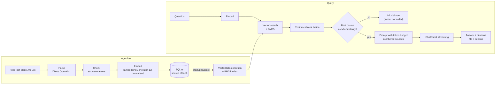

# Local RAG Assistant (.NET + Foundry Local)

Production-minded local RAG in .NET: documents are parsed, chunked, embedded and answered **on the device** with
[Foundry Local](https://github.com/microsoft/Foundry-Local). The point of the project is not "how to call a local
model" but the parts that decide whether a local RAG is any good: provider-neutral abstractions, chunking,
embedding consistency, retrieval beyond top-k, small-model guard rails, and an evaluation you can re-run.

```
src/LocalRag.Core        provider-neutral pipeline (ingest, index, retrieve, prompt, answer). No Foundry types.
src/LocalRag.Foundry     Foundry Local lifecycle + adapters to IChatClient / IEmbeddingGenerator
src/LocalRagAssistant    ASP.NET Core minimal API + small web UI (streaming answers with citations)
tests/LocalRag.Tests     29 xUnit tests; run without any model (fake embedder / scripted chat)
eval/LocalRag.Eval       golden questions + benchmark harness that writes a Markdown report
eval/corpus, golden.jsonl  the reproducible evaluation data
```

## Pinned versions

| Component | Version |
|---|---|
| .NET SDK / target | 10.0.201 (`global.json`) / `net10.0` |
| `Microsoft.AI.Foundry.Local` | 2.0.1 |
| `Microsoft.Extensions.AI.Abstractions` | 10.10.1 (via Core) |
| `Microsoft.Extensions.VectorData.Abstractions` | 10.1.0 |
| `Microsoft.SemanticKernel.Connectors.InMemory` (**preview**) | 1.74.0-preview |
| `Microsoft.Extensions.AI.Evaluation.Quality` | 10.10.0 |
| Chat model (default) | `phi-3.5-mini` -> `Phi-3.5-mini-instruct-generic-cpu:2` |
| Embedding model (default) | `qwen3-embedding-0.6b` -> `qwen3-embedding-0.6b-generic-cpu:1` |

Foundry Local moves fast. These are the versions this repo was built and measured against; re-check release notes
before upgrading. Foundry Local now ships its own embeddings, which is why this project does not need a separate ONNX
embedding library.

## Architecture



### Why it is built this way

* **Provider portability.** `LocalRag.Core` references only `Microsoft.Extensions.AI.Abstractions` and
  `Microsoft.Extensions.VectorData.Abstractions`. Foundry Local is one `AddFoundryLocal()` call in `Program.cs`;
  Azure OpenAI/Ollama means registering a different `IChatClient` + `IEmbeddingGenerator` and dropping that line. The
  Core and Eval code do not change.
* **SQLite is the source of truth; the vector index is derived.** Chunks and embeddings persist in one SQLite file;
  at startup they are loaded into a `VectorStoreCollection` (in-memory connector) and a BM25 index. Restarts do not
  need the embedding model. The index swap point is `VectorIndex` (see "Vector store choice").
* **Embedding consistency is enforced, not assumed.** The index records which embedding model/dimension built it.
  Querying with another model throws `ReindexRequiredException` (HTTP 409); ingesting with another model wipes and
  rebuilds. Vectors are L2-normalised at write and query time, so cosine similarity equals a dot product and a
  single similarity threshold is meaningful.

## Run it

Requirements: Windows x64 (the project is configured for `win-x64`), .NET 8 SDK. **No separate Foundry install or CLI
is needed**: the SDK bundles the runtime (verified: runs on a machine without the `foundry` CLI on PATH).

```powershell
dotnet run --project src/LocalRagAssistant     # http://localhost:5230 (see launchSettings.json)
```

First run downloads the models and caches them under `%USERPROFILE%\.<AppName>\cache\models` (so changing
`Rag:AppName` re-downloads them):

| Model | On disk |
|---|---|
| `phi-3.5-mini` (CPU variant) | 2.6 GB |
| `qwen3-embedding-0.6b` (CPU variant) | 0.5 GB |

The web server starts immediately; `GET /health` shows each model going `Downloading` -> `Loading` -> `Ready`, with
download progress, variant id and load time (the cold-start cost). Open `http://localhost:5230/` for the UI.

### Hardware requirements

Both default models run **in the app's process on CPU** and need on the order of 3.5 GB of free RAM together (an estimate from the
2.6 GB + 0.5 GB on-disk sizes, not a measurement). On the 16 GB development machine, with about 2.3 GB free
(browser + IDE open), **`phi-3.5-mini` failed to load with `bad allocation`, and when it was loaded
anyway, the embedding model then ran out of memory mid-ingestion**. The app reports this as a failed model state
and failed documents rather than crashing. Close memory-hungry apps, use a smaller chat model, or set
`Rag:LoadChatModel=false` for ingestion/retrieval-only use.

### API

| Endpoint | Purpose |
|---|---|
| `GET /health` | runtime, per-model lifecycle + timings, indexed chunk count |
| `POST /ingest` | sync `Rag:DocumentsFolder`; add `multipart/form-data` files to upload them there first |
| `GET /documents`, `DELETE /documents?source=` | list / remove indexed documents |
| `POST /ask` `{ "query": "..." }` | `{ "answer": "..." }` (final answer only, no streaming) |

`/ask` returns 503 if a model is not ready and 409 if the index needs rebuilding. The browser UI streams tokens, can be
cancelled with **Stop** (cancellation propagates to generation), shows each source as `file > section` with its
similarity, and highlights the sources the answer actually cited.

## Ingestion

* **Idempotent.** Files are keyed by relative path (`a/policy.md` and `b/policy.md` do not collide) and a SHA-256 of their
  bytes. Re-running skips unchanged files (no re-embedding: see the "Re-run" column below), replaces changed ones in a
  single SQLite transaction (a crash leaves the old version intact), and removes documents whose file was deleted.
  A change of chunking settings or embedding model also re-indexes.
* **One bad file never aborts the run.** Unparseable files, empty/scanned PDFs, files over `MaxFileBytes` (20 MB) and
  documents over `MaxChunksPerDocument` (2000) are reported per file in `failures`.
* **Chunking** (`Rag:Chunking`):
  * `Fixed`: sliding word window with overlap.
  * `Structured` (default): splits on Markdown/DOCX headings and "3. Warranty"-style numbered headings, packs whole
    paragraphs up to the size limit, falls back to a window only for oversized paragraphs, and prefixes every chunk
    with its heading path (and a short document title if there is one). The path is both embedded and shown as the
    citation section.
  * Whole-document embedding fails because one vector must represent every topic in the file; queries then match
    "the document" weakly and the prompt receives far more text than the answer needs.

## Retrieval and generation guard rails

1. Vector search (cosine) and, if `HybridSearch`, BM25 keyword search (catches error codes, SKUs and names that
   embeddings blur), fused with reciprocal rank fusion. Optional `source` filter (file or folder prefix).
2. **Confidence gate.** If the best cosine similarity is below `MinSimilarity` (default 0.40), the app answers
   "I don't have enough information..." **without calling the model**. Plain top-k always returns something, which is
   what lets a small model improvise on irrelevant context. The threshold is model-specific; see calibration below.
3. **Token budget.** Chunks are added in rank order until `MaxContextTokens` (~4 chars/token estimate) is spent; the best chunk
   is always kept (truncated if necessary).
4. **Grounded, cited prompt.** Numbered sources, "cite like [1]", an exact abstain phrase. After generation the answer's `[n]`
   markers are validated against the real sources (invented numbers are ignored) and a model-side refusal is flagged.

Not implemented (deliberately, to be honest about scope): reranking with a cross-encoder, per-document permissions
(this is a single-user design), query rewriting.

## Evaluation

```powershell
dotnet run --project eval/LocalRag.Eval -c Release -- --label my-laptop              # ingestion + retrieval
dotnet run --project eval/LocalRag.Eval -c Release -- --label my-laptop --generate   # + TTFT, tokens/s, citations, abstention
dotnet run --project eval/LocalRag.Eval -c Release -- --generate --judge             # + Microsoft.Extensions.AI.Evaluation groundedness
dotnet run --project eval/LocalRag.Eval -c Release -- --Rag:RegisterExecutionProviders=true --label gpu   # another hardware profile
```

Any `--Rag:Key=Value` overrides configuration. Reports land in `eval/results/`. Data: `eval/corpus` (3 short documents
with a fictional field-engineering handbook) and `eval/golden.jsonl` (12 answerable, 4 unanswerable questions, each
with an expected source and an evidence phrase). `--judge` uses the local chat model as the LLM judge, so its scores are
indicative only; the default groundedness check is a deterministic heuristic (valid citation + most answer words and
all numbers present in the retrieved text).

### Results: AMD Ryzen (12 logical cores), 15 GB RAM, CPU only, Windows 11

Source: [`eval/results/dev-box-embedding-only-*.md`](eval/results). Only retrieval and ingestion were measured on this machine: see
the hardware note above for why generation could not run here.

| Variant | Chunks | Ingest (s) | Hit@1 | Hit@4 | Similarity margin* | Right abstention @0.40 |
|---|---|---|---|---|---|---|
| fixed 300 words + vector (~one chunk per file) | 3 | 11.7 | 12/12 | 12/12 | **-0.03** | 14/16 |
| fixed 60 words + vector | 16 | 25.6 | 12/12 | 12/12 | +0.11 | 16/16 |
| structured 300 + vector | 15 | 22.5 | 12/12 | 12/12 | +0.04 | 16/16 |
| structured 300 + hybrid | 15 | 24.1 | 12/12 | 12/12 | +0.04 | 16/16 |

\* lowest top-similarity among answerable questions minus highest among unanswerable ones. Above zero, one threshold can
separate "answerable" from "unanswerable".

How to read this honestly:

* **The corpus is small and easy.** Every variant gets Hit@1 = 100%, so this set cannot show hybrid search or
  structure-aware chunking improving *ranking*. Only the similarity margin differentiates the variants. Do not read the tiny
  corpus as proof that any variant is better; grow `golden.jsonl` with your own documents before drawing conclusions.
* What it does show: whole-document-sized chunks give the worst margin (-0.03, i.e. an unanswerable question scored
  higher than an answerable one), so the confidence gate cannot work. Smaller chunks separate much better. In this run
  plain 60-word windows had a *better* margin than structure-aware chunks; structure-aware chunking's benefit here is
  that citations carry a section name and facts are not split mid-sentence, not a retrieval-score win.
* **Calibrating `MinSimilarity`:** answerable top scores ranged 0.43-0.69 and unanswerable ones up to 0.39 for the structured
  variant. The 0.40 default sits in a 0.04 gap, which is why the model-side refusal instruction is kept as a second line of defence. Re-run the
  eval on your documents and set the threshold from your own distribution.
* **Ingestion is slow on CPU:** ~0.5-0.7 chunks/s (about 1.5 s per ~300-word chunk) on this machine, while the machine was
  low on memory. An unchanged re-run takes milliseconds. Ingesting thousands of chunks is a minutes-to-hours job; plan for it,
  or use a GPU/NPU profile.
* Process working set after ingestion: ~890 MB with only the embedding model loaded.
* Cold start: embedding model load 3.3 s (cached); `phi-3.5-mini` load 27 s when memory allowed (one run).

**Not yet measured (do these on your hardware):** time to first token, tokens/s, answer groundedness, GPU/NPU profile and VRAM.
The harness produces all of these with `--generate` (and `--Rag:RegisterExecutionProviders=true` for GPU/NPU); a second
hardware profile has not been run.

## Choices worth knowing about

### In-process SDK vs. the OpenAI-compatible endpoint
This project uses Foundry Local's **in-process** clients (adapted to `IChatClient`/`IEmbeddingGenerator`): no HTTP hop, no
port to discover, lifecycle managed by the SDK. The alternative is to start Foundry Local's local web service and talk
to it with any OpenAI-compatible client (works from other processes/languages and lets several apps share one loaded
model, at the cost of a localhost HTTP round-trip and having to discover the port from the SDK rather than hardcoding
it). Because Core depends only on the M.E.AI abstractions, switching is a different `IChatClient` registration.

### Vector store choice
| Option | Persistence | Footprint | Scale | Fit |
|---|---|---|---|---|
| In-memory collection + SQLite rows (this repo) | SQLite file, reloaded at start | RAM = all vectors (~4 KB per 1024-dim chunk) | up to ~100k chunks comfortably | single-user desktop assistant |
| SQLite with a vector extension (`sqlite-vec`) | native | small | larger than RAM | desktop/offline app with big corpora (connector is still preview) |
| Local Qdrant (container/service) | native | separate process | millions, filtered, multi-user | on-prem team service |

Only `VectorIndex` constructs the store, so changing connectors is local to that class.

### Privacy: what is verified and what is not
* Models are downloaded **once** on first run (that is the only network use by this app; the SDK's own catalog lookups are
  the SDK's). Documents, chunks, embeddings, questions and answers are processed in-process and stored in a local SQLite file
  (`data/rag.db`) + the model cache above. I did **not** run a packet capture or an air-gapped test; to verify on your
  network, run once to cache the models, disconnect and confirm ingestion + `/ask` still work, and watch outbound traffic
  during a run.
* **Not encrypted at rest** by this app. Use BitLocker/disk encryption; the database holds the full text of your documents.
* **No per-document permissions**: anyone who can reach the API can query everything. Do not expose it to a team without adding
  authentication and per-chunk ACL filtering.
* `/ingest` only reads the configured documents folder (no arbitrary server paths) and strips directory components from uploaded
  file names.

## Local vs. cloud RAG

| | Local (this repo) | Cloud (Azure OpenAI + AI Search) |
|---|---|---|
| Privacy | data never leaves the machine (to be verified as above) | data processed by provider under contract |
| Cost | hardware you already own; no per-token fee | per-token + index fees |
| Latency | CPU: seconds to first token, slow generation; GPU/NPU better | low and consistent |
| Answer quality | small models: weaker instruction-following, more refusals/hallucination under weak retrieval | substantially stronger |
| Scale | one machine, tens of thousands of chunks | effectively unlimited, multi-user |
| Ops effort | model downloads, RAM/driver issues, no HA | managed |

Local is the right answer for air-gapped sites, regulated data that must not leave the network, and offline field laptops.
Cloud (or hybrid: local retrieval + cloud generation on non-sensitive excerpts) is better when you need top answer quality,
many concurrent users, or large corpora. Because of the abstractions, trying both is a configuration change.

## Known limitations

* CPU-only by default; generation speed and ingestion throughput are modest (see results). GPU/NPU: `Rag:RegisterExecutionProviders=true`, unmeasured here.
* Both models need to fit in RAM together (see hardware note).
* Scanned/image-only PDFs have no text and are rejected (no OCR). PDF heading structure is lost; only numbered-heading heuristics apply.
* Windows x64 only as configured (`RuntimeIdentifiers`); Foundry Local supports more platforms but this project was not tested on them.
* The in-memory vector connector is a preview package; the token estimate is a character heuristic.
* The Foundry SDK's `OpenAIChatClient`/`OpenAIEmbeddingClient` are marked obsolete in 2.0.1 in favour of session types; the adapters isolate that.
* Chat model settings (max tokens/temperature) are applied per request on a shared client; concurrent requests are serialised for that step only.
* PDF extraction uses iText7 (**AGPL**): review the licence before shipping closed-source or as a hosted service.

## Tests

```powershell
dotnet test
```
Covers chunking, BM25, token budgeting, idempotent ingestion (no re-embedding, update, delete, bad files, size limits,
embedding-model change), restart hydration, retrieval gating/filtering/hybrid, and the answer pipeline's abstention and
citation handling: all with a deterministic fake embedder and a scripted chat client (no model needed).

## Configuration (`Rag` section of `src/LocalRagAssistant/appsettings.json`)

`ChatModelAlias`, `EmbeddingModelAlias`, `Chunking` (`Fixed`/`Structured`), `ChunkSizeWords`, `ChunkOverlapWords`, `TopK`,
`CandidateCount`, `HybridSearch`, `MinSimilarity`, `MaxContextTokens`, `MaxAnswerTokens`, `Temperature`, `DocumentsFolder`,
`DatabasePath`, `MaxFileBytes`, `MaxChunksPerDocument`, `EmbeddingBatchSize`, `LoadChatModel`, `RegisterExecutionProviders`.
Options are validated at startup. Run `foundry model list` (if you have the CLI) or browse the catalog for other aliases.
